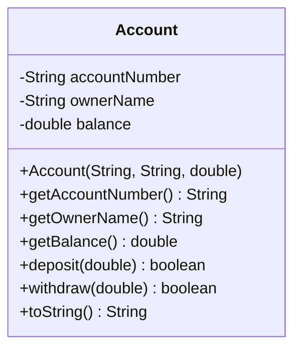
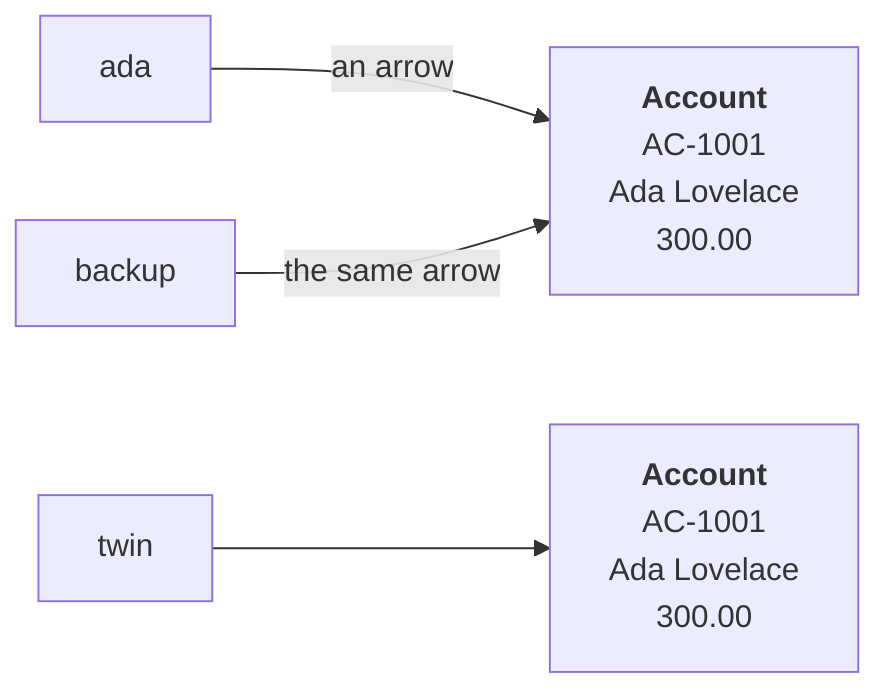

# Week 2. Classes and references

[Your first class](https://evisp.github.io/java-oop-course/01-objects-and-state/first-class/) — fields, one constructor, methods, `toString`.

[What a variable really holds](https://evisp.github.io/java-oop-course/01-objects-and-state/references/) — references, aliasing, `null`, `==`.

## What is in this folder

| File | What it is for |
|---|---|
| `Account.java` | The class, properly written. No validation yet. |
| `BankApp.java` | Creates accounts and prints them. All user-facing text is here. |
| `ReferenceDemo.java` | Four blocks. Predict each one before running it. |

## What changed from week 1

`Account` gains an account number, an owner and a `toString`, plus `deposit`
alongside `withdraw`.

Still no validation. The constructor accepts a null owner and a negative
opening balance, and `BankApp` ends by showing exactly that. Week 3 closes it.

`Account` still never prints.

## The design



Three getters and no setters. That is the design, not an oversight. There is
no `setBalance`, because handing back the power to set a balance to anything
would undo what `private` just bought.

## What a variable holds



`ada` and `backup` reach the same account, so a withdrawal through either is
visible through both. `twin` holds identical values in a different object, so
`ada == twin` is `false`. `==` compares arrows, not contents.

## Run it

**`BankApp`**

```text
Account AC-1001 (Ada Lovelace): 500.00 EUR

Withdrawal accepted.
Not enough money.
Account AC-1001 (Ada Lovelace): 300.00 EUR

Account AC-1001 (Ada Lovelace): 300.00 EUR
Account AC-1002 (Alan Turing): 2400.00 EUR
Account AC-1003 (Grace Hopper): 1500.00 EUR

What this class still lets through:
  Account AC-1004 (null): -5000.00 EUR
  Account  (): 0.00 EUR
Week 3 fixes that.
```

**`ReferenceDemo`**

```text
--- 1. Two names, one object
  ada.getBalance()    = 300.0
  backup.getBalance() = 300.0

--- 2. Two objects with identical values
  ada == backup : true
  ada == twin   : false

  a == b       : false
  a.equals(b)  : true

--- 3. null
  closed == null : true
  Now asking a null for its balance:
  Cannot invoke "Account.getBalance()" because "closed" is null

--- 4. Passing to a method
  before applyFee : 1000.0
  after  applyFee : 995.0
  before replace  : Alan Turing
  after  replace  : Alan Turing
```

The last two lines are the ones worth staring at. `applyFee` changed the
account. `replace` did not, because it only moved its own arrow.

## Try this

In `ReferenceDemo`, replace `new String("AC-1001")` with plain literals:

```java
String a = "AC-1001";
String b = "AC-1001";
```

`a == b` now prints `true`, because Java reuses identical literals. That is why
`==` on strings appears to work, and why it silently stops working the moment
the text comes from a file or from user input.

Use `.equals()` for strings. Always.

## Next

Week 3 makes the constructor refuse, locks what never changes, and lets the
account issue its own number.